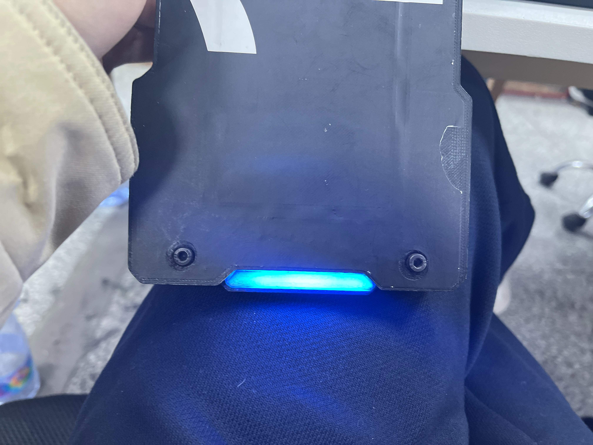

# 题目

利用 OpenCV 实现：在摄像头中，注意不是imgs里面给你的图片，而是摄像头里面一个真实的装甲板，识别出装甲板（如何识别见如下要求）,因为这次作业需要装甲板，我建议你们先拿imgs里面的图片做测试，然后用videos里面的视频做测试，最后有空可以来实验室借一借装甲板做实体测试（在实验室里面用，不能带走!带走了你学长就没装甲板测自瞄啦！）
 
### 要求:
1. 用矩形框出装甲板或者框出两个灯条

2. 灯条有红色的有蓝色（如下面两个图），要求可以通过仅修改一两个启动参数即可切换识别的灯条颜色

3. 无论远近均可准确识别，即装甲板与摄像头的距离不是固定不变的，无论装甲板离摄像头多远均可识别（当然不会远的离谱）

4. 识别出灯条后再标出装甲板的中心，可以在图像上画个圆点来表示装甲板中心

4. 尽量要有 *自述文件*（即readme.md文件，阐述一下自己的思路和遇到的困难）

5. 所有的代码需要有注释详细说明

### 装甲板灯条：
红色灯条装甲板

蓝色灯条装甲板

红色单灯条

蓝色单灯条

提交结构:
├── includes
│   └── opencv.hpp
├── test(测试图片，你们中途测试的图片可以放在此文件夹，如果没有就不用放)
│   ├── test1.png
│   ├── test2.png
│   └── test3.png
├── readme.md
└── src
   └── opencv.cpp

>imgs和videos目录可以不用交
> 整个程序打包发到1376982098@qq.com邮箱

